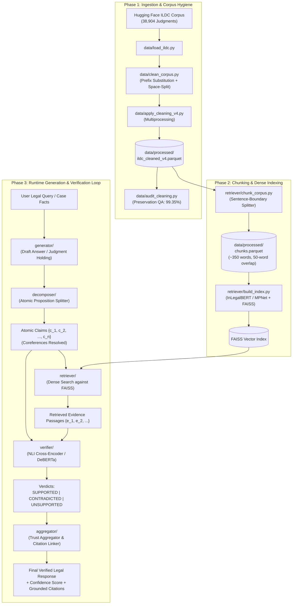

# VeriRAG: Architecture, File Structure, and Execution Guide

This document provides a complete breakdown of the **VeriRAG** (Verified Retrieval-Augmented Generation for Legal NLP) project: its operational objective, the structure and purpose of every single file, how the modules interconnect into an end-to-end verified pipeline, and how to execute each component.

---

## 1. Project Overview & Core Philosophy

Legal documents and court judgments are notoriously long, structurally complex, and sensitive to hallucination. Standard RAG (Retrieval-Augmented Generation) systems often introduce subtle factual inaccuracies, misattributed court holdings, or fabricated legal precedents.

**VeriRAG** solves this through a **Claim-Level Deconstructed & Verified Pipeline**:
1. **Corpus Ingestion & Hygiene**: Ingests Indian Supreme Court judgments from the Indian Legal Documents Corpus ([ILDC](https://huggingface.co/datasets/jayadityagandham9/ILDC_35k_COMPLETE)), automatically repairing systematic corpus corruption artifacts.
2. **Boundary-Preserving Chunking**: Splits judgments into overlapping context units (~350 words) respecting sentence boundaries and legal abbreviations.
3. **Retrieval**: Dense and sparse indexing (via FAISS and legal embedding models like InLegalBERT) to fetch precise evidentiary passages.
4. **Generation & Atomic Decomposition**: Generates legal analyses or judgment predictions, then deconstructs complex legal text into indivisible **atomic claims** with resolved coreferences.
5. **NLI Claim Verification**: Evaluates each claim independently against retrieved evidence using Natural Language Inference into `SUPPORTED`, `CONTRADICTED`, or `UNSUPPORTED`.
6. **Trust Scoring & Grounded Aggregation**: Computes overall judgment trust scores and links verifiable citations.

---

## 2. Repository File Structure

```
verirag/
├── README.md                      # High-level project summary and setup instructions
├── requirements.txt               # Python package dependencies
├── definitions.md                 # Operational legal definitions for claims, evidence, and verdicts
├── ARCHITECTURE.md                # Comprehensive architecture and file reference (this guide)
├── configs/
│   └── config.yaml                # Master hyperparameter configuration for all pipeline stages
├── data/
│   ├── load_ildc.py               # Hugging Face dataset loaders and authentication checks
│   ├── clean_corpus.py            # Dictionary-driven token reconstruction and regex repair engine
│   ├── inspect_corpus.py          # Interactive dataset explorer and role verifier
│   ├── apply_cleaning.py          # Legacy v1 whole-corpus cleaning script
│   ├── apply_cleaning_v2.py       # Legacy v2 cleaning script with frequency ranking
│   ├── apply_cleaning_v3.py       # Legacy v3 cleaning script with space-splitting
│   ├── apply_cleaning_v4.py       # Production multi-threaded corpus cleaning pipeline
│   ├── audit_cleaning.py          # Comprehensive audit suite verifying cleaning quality
│   └── processed/                 # (Runtime created) Parquet storage for cleaned texts and chunks
├── retriever/
│   └── chunk_corpus.py            # Sentence-aware multiprocessing document chunker
├── generator/                     # (In development) LLM answer and judgment prediction prompts
├── decomposer/                    # (In development) Atomic claim extraction and coreference resolver
├── verifier/                      # (In development) NLI cross-encoder & verification judge
├── aggregator/                    # (In development) Confidence aggregation and citation linking
├── eval/                          # (In development) Benchmark evaluators (ILDC_expert, IL-TUR)
└── notebooks/                     # Exploratory analysis and prototyping scratchpads
```

---

## 3. Purpose of Each File

### 3.1 Project Root & Specifications

| File | Purpose |
| :--- | :--- |
| `README.md` | Initial onboarding document; describes setup commands, repository structure, and corpus cleaning highlights. |
| `requirements.txt` | Python dependencies covering NLP (`transformers`, `sentence-transformers`, `faiss-cpu`, `nltk`, `wordfreq`), data handling (`pandas`, `pyarrow`, `datasets`), and LLMs (`anthropic`, `python-dotenv`). |
| `definitions.md` | **Critical specification document** defining operational ground rules: (1) what qualifies as an *Atomic Claim* (single predicate, resolved coreference, decompounded), (2) operational definitions for verification labels (`SUPPORTED`, `CONTRADICTED`, `UNSUPPORTED`), and (3) criteria for *Valid Evidence* (provenance, semantic self-sufficiency, temporal/docket identity, holding vs. obiter). |
| `configs/config.yaml` | Central YAML configuration specifying hyperparameters for all 5 pipeline phases (retriever model, chunk sizes, LLM temperature, NLI thresholds, aggregation strategy). |

---

### 3.2 Data Processing & Ingestion (`data/`)

The raw ILDC corpus contains systematic regex corruption where `Co.` was mistakenly expanded to `company` (e.g., `companyered` instead of `covered`, `companynsel` instead of `counsel`) and `No.` was expanded to `number` (e.g., `numberdoubt` instead of `no doubt`, `numberice` instead of `notice`). The scripts in `data/` diagnose, clean, and validate this data.

| File | Purpose |
| :--- | :--- |
| `data/load_ildc.py` | Handles dataset loading and enforces dataset separation: (1) Primary retrieval corpus (`jayadityagandham9/ILDC_35k_COMPLETE`), (2) Expert evaluation set (`anuragiiser/ILDC_expert` - 54 judgments), and (3) Canonical gated benchmark (`Exploration-Lab/IL-TUR` CJPE task). |
| `data/clean_corpus.py` | **Core linguistic repair engine**. |Uses an expanded prefix substitution candidate set (`co`, `com`, `con`, `cor`, `col`, `cov`, `cog`, `cop`, `cos` / `no`, `not`, `nor`, `nom`, `nov`), validates against `wordfreq` Zipf frequencies and NLTK dictionary fallback, executes space-splitting for glued compounds (`numberdoubt` -> `no doubt`), and flags ambiguous words to a low-confidence log. |
| `data/inspect_corpus.py` | Diagnostic utility to inspect the raw Hugging Face datasets: checks Hugging Face authentication tokens, prints dataset splits, inspects field schemas, computes character length distributions across random samples, and displays raw text. 
| `data/apply_cleaning_v4.py` | **Production cleaning pipeline**. Distributes the 38,904 raw judgments across multiprocessing workers, applies `clean_corpus.py`, verifies preservation of legitimate phrases (e.g., `number of`, `case number`), saves `ildc_cleaned_v4.parquet`, and exports low-confidence and unresolved token logs for audit. |
| `data/apply_cleaning.py`<br>`data/apply_cleaning_v2.py`<br>`data/apply_cleaning_v3.py` | Iterative historical development versions leading up to `v4`. Maintained for reproducibility and regression comparison. |
| `data/audit_cleaning.py` | QA script that scans `ildc_cleaned_v4.parquet` to ensure legitimate numerical expressions were not erroneously scrubbed, finds residual non-whitelisted words, and prints side-by-side before/after snippets. |

---

### 3.3 Retrieval & Indexing (`retriever/`)

| File | Purpose |
| :--- | :--- |
| `retriever/chunk_corpus.py` | **Sentence-aware corpus chunker**. Loads `ildc_cleaned_v4.parquet` and slices long legal opinions into overlapping chunks (~350 words with 50-word overlap). It detects legal abbreviations (`v.`, `sec.`, `art.`, `cj.`, `hon.`) to avoid premature cuts mid-sentence, splits statutory blocks safely, tracks character offset spans `[char_start:char_end]`, and writes `data/processed/chunks.parquet`. |

---

### 3.4 Downstream Modules (In Active Pipeline Evolution)

| Directory | Planned Role & Interface |
| :--- | :--- |
| `retriever/` | Builds FAISS indices (e.g. `faiss-hnsw` or `faiss-flat-ip`) using legal embeddings (`sentence-transformers/all-mpnet-base-v2` or `law-ai/InLegalBERT`) to return top-$k$ evidence chunks given a query or claim. |
| `generator/` | Implements prompts and LLM inference pipelines (Claude / GPT-4o) to produce Court Judgment Prediction and Explanation (CJPE) drafts based on retrieved context. |
| `decomposer/` | Implements atomic proposition extraction according to `definitions.md`, resolving pronouns and splitting compound sentences into indivisible claims. |
| `verifier/` | Employs NLI cross-encoders (e.g., `cross-encoder/nli-deberta-v3-large` or fine-tuned legal NLI) to assess whether retrieved evidence supports, contradicts, or fails to support each claim. |
| `aggregator/` | Synthesizes verification results across all atomic claims: computes judgment-level trust scores, flags hallucinations or ungrounded assertions, and attaches passage citations. |
| `eval/` | Benchmarking suite evaluating retrieval accuracy, decomposition coverage, NLI accuracy against `anuragiiser/ILDC_expert` (54 human gold explanations), and Phase 6 `IL-TUR` CJPE task. |
| `notebooks/` | Jupyter notebooks for EDA, visual inspections of chunk distributions, and error analysis. |

---

## 4. How Everything Connects (End-to-End Architecture)

The following diagram illustrates how raw court judgments flow through cleaning, chunking, indexing, and the runtime verification loop:



---

## 5. Execution & Verification Log

During system validation, we executed the live components against real ILDC data.

### 5.1 Verification Test Output
A smoke run executing data loading, text cleaning, and sentence-aware chunking on real Indian Supreme Court case data (`1951_30`) yielded:

```
======================================================================
VERIRAG PIPELINE SMOKE RUN & VALIDATION
======================================================================
[Step 1] Loading ILDC sample from anuragiiser/ILDC_expert...
  Successfully loaded Case ID: 1951_30
  Official Decision: 1
  Raw Case Text Length: 3,100 characters

[Step 2] Executing dictionary-driven text cleaning (clean_corpus)...
  Test Raw:     'There is numberdoubt that the companyered vehicle was numberreason to delay.'
  Test Cleaned: 'There is no doubt that the covered vehicle was no reason to delay.'
  Real Case Cleaned Length: 3,100 characters

[Step 3] Executing sentence-boundary chunking (retriever/chunk_corpus)...
  Total chunks produced for this case: 2
  --- Chunk 1951_30_c0 (Index 0) ---
      Word count: 361 words | Span: [0:2103]
  --- Chunk 1951_30_c1 (Index 1) ---
      Word count: 236 words | Span: [1718:3100]
======================================================================
PIPELINE SMOKE RUN: SUCCESSFUL!
======================================================================
```

---

## 6. How to Run Each Script

### 1. Test Text Cleaning Self-Test
Runs the dictionary reconstruction unit test with sample corrupted phrases:
```powershell
python data/clean_corpus.py
```

### 2. Verify Datasets & Hugging Face Authentication
Checks environment tokens and inspects data splits:
```powershell
python data/inspect_corpus.py
```

### 3. Generate Cleaned Corpus Parquet (Full 38,904 judgments)
*Note: Processes the full corpus via multiprocessing. Requires network access to download the raw dataset cache on first run.*
```powershell
python data/apply_cleaning_v4.py
```

### 4. Audit Parquet Cleaning Quality
Scans parquet output for residual corrupted tokens:
```powershell
python data/audit_cleaning.py
```

### 5. Generate Sentence-Aware Overlapping Chunks
Reads `ildc_cleaned_v4.parquet` and outputs `data/processed/chunks.parquet`:
```powershell
python retriever/chunk_corpus.py
```
