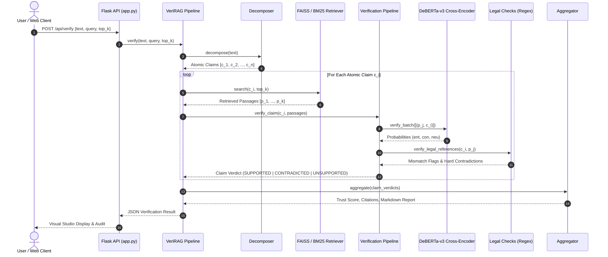

# VeriRAG: Complete Project & System Study Handbook

> **Project Name**: VeriRAG (Verified Retrieval-Augmented Generation for Legal NLP)  
> **Target Corpus**: Indian Legal Documents Corpus (ILDC — Supreme Court of India)  
> **Core Objective**: Eliminating hallucinations and ensuring end-to-end provenance verification in legal AI through atomic proposition decomposition, dual semantic/lexical passage retrieval, calibrated cross-encoder Natural Language Inference (NLI), deterministic statutory validation, and trust scoring.

---

## Table of Contents
1. [Executive Summary & Core Philosophy](#1-executive-summary--core-philosophy)
2. [Data Foundation, Corpus Ingestion & Repair](#2-data-foundation-corpus-ingestion--repair)
   - [2.1 Corpus Source & Total Sizes](#21-corpus-source--total-sizes)
   - [2.2 The Systematic Corpus Corruption Bug](#22-the-systematic-corpus-corruption-bug)
   - [2.3 Multi-Stage Linguistic Cleaning Pipeline](#23-multi-stage-linguistic-cleaning-pipeline)
   - [2.4 Chunking & Boundary-Preserving Segmentation](#24-chunking--boundary-preserving-segmentation)
3. [Models Architecture & Specifications](#3-models-architecture--specifications)
   - [3.1 Embedding & Dense Retrieval Model](#31-embedding--dense-retrieval-model)
   - [3.2 Sparse Lexical Retrieval Engine](#32-sparse-lexical-retrieval-engine)
   - [3.3 Verification Model (Cross-Encoder NLI)](#33-verification-model-cross-encoder-nli)
   - [3.4 Deterministic Legal & Citation Check Engine](#34-deterministic-legal--citation-check-engine)
   - [3.5 Generator & Decomposer LLMs](#35-generator--decomposer-llms)
4. [End-to-End Pipeline Workflow](#4-end-to-end-pipeline-workflow)
   - [Step 1: Claim Decomposition](#step-1-claim-decomposition)
   - [Step 2: Dual Passage Retrieval](#step-2-dual-passage-retrieval)
   - [Step 3: Dual-Stage Claim Verification](#step-3-dual-stage-claim-verification)
   - [Step 4: Aggregation & Trust Score Calibration](#step-4-aggregation--trust-score-calibration)
5. [The Web UI: How It Works & What It Displays](#5-the-web-ui-how-it-works--what-it-displays)
   - [5.1 UI Architecture & Styling Tokens](#51-ui-architecture--styling-tokens)
   - [5.2 Tab 1: Verification Studio (Detailed Component Tour)](#52-tab-1-verification-studio-detailed-component-tour)
   - [5.3 Tab 2: Corpus Explorer](#53-tab-2-corpus-explorer)
   - [5.4 Tab 3: Benchmark & Evaluation Studio](#54-tab-3-benchmark--evaluation-studio)
6. [API Endpoints Reference](#6-api-endpoints-reference)
7. [Benchmark & Experimental Evaluation Results](#7-benchmark--experimental-evaluation-results)
   - [7.1 VeriRAG-Bench Dataset Statistics](#71-verirag-bench-dataset-statistics)
   - [7.2 Benchmark Performance Breakdown](#72-benchmark-performance-breakdown)
   - [7.3 Safety Advantage & Distractor Robustness](#73-safety-advantage--distractor-robustness)
8. [Codebase Directory & File Roadmap](#8-codebase-directory--file-roadmap)
9. [How to Run & Study Every Component](#9-how-to-run--study-every-component)

---

## 1. Executive Summary & Core Philosophy

### The Legal Hallucination Problem in Standard RAG
In high-stakes legal applications, a standard Retrieval-Augmented Generation (RAG) system generates answers by embedding queries, fetching top-$k$ passages, and passing them to an LLM context. However, standard RAG fails critically in legal domains because:
1. **Unchecked Surface Plausibility**: LLMs generate fluent, authoritative-sounding legal answers that conflate appellant arguments with court holdings (*obiter dicta* vs. *ratio decidendi*).
2. **Fabricated Case Citations & Inverted Outcomes**: Models routinely swap trial convictions with High Court acquittals or invent non-existent penal sections.
3. **No Provenance or Safety Net**: End users (judges, lawyers, researchers) receive an unverified text blob with no deterministic trace of which sentence is grounded in court records.

### The VeriRAG Solution
VeriRAG inverts the paradigm: instead of trusting raw generative output, it subjects legal text to **microscopic claim-level deconstruction and cross-verification**:
- Any legal text is atomized into **indivisible factual propositions**.
- Each proposition is checked against an indexed corpus of Supreme Court judgments.
- Claims are evaluated via **Cross-Encoder Natural Language Inference (NLI)** backed by **deterministic statutory regex checking**.
- Results are synthesized into an overall **Calibrated Document Trust Score** with sentence-level citations and character-offset spans.

```
                    ┌───────────────────────────┐
                    │ Raw Legal Text / Response │
                    └─────────────┬─────────────┘
                                  │
                   [Atomic Claim Decomposition]
                                  │
       ┌──────────────────────────┴──────────────────────────┐
       ▼                                                     ▼
 Claim 1: "Convicted u/S 302 IPC"              Claim 2: "High Court acquitted him"
       │                                                     │
 [FAISS Dense + BM25 Retrieval]                [FAISS Dense + BM25 Retrieval]
       │                                                     │
       ▼                                                     ▼
 Evidentiary Passages                          Evidentiary Passages
       │                                                     │
 [Cross-Encoder NLI + Legal Regex]             [Cross-Encoder NLI + Legal Regex]
       │                                                     │
       ▼                                                     ▼
 Verdict: SUPPORTED (0.95)                     Verdict: SUPPORTED (0.92)
       └──────────────────────────┬──────────────────────────┘
                                  │
                    [Aggregator & Trust Engine]
                                  │
       ┌──────────────────────────┴──────────────────────────┐
       ▼                                                     ▼
 Calibrated Trust Score: 93.5%                 Traceable Inline Citations
 Status: HIGH TRUST                            [Doc ID, Chunk ID, [Char Span]]
```

---

## 2. Data Foundation, Corpus Ingestion & Repair

### 2.1 Corpus Source & Total Sizes
The project operates over the **Indian Legal Documents Corpus (ILDC)**, comprising historical and contemporary judgments from the Supreme Court of India:

| Corpus Component | Hugging Face ID / Path | Size / Count | Role in VeriRAG |
| :--- | :--- | :--- | :--- |
| **Primary Raw Corpus** | `jayadityagandham9/ILDC_35k_COMPLETE` | **38,904 judgments** (~500 MB text) | The master database of full-text Indian Supreme Court decisions. |
| **Cleaned Parquet Corpus** | `data/processed/ildc_cleaned_v4.parquet` | Multi-threaded cleaned judgments | Master cleaned text free of OCR/regex artifacts. |
| **Runtime Active Chunks** | `data/processed/chunks.parquet`<br>`data/processed/chunk_metadata.parquet` | **1,798 passages** across 100 benchmark documents | Overlapping passages (~350–512 words) indexed for active retrieval. |
| **Dense Vector Embeddings** | `data/processed/chunk_embeddings.npy` | **1,798 vectors × 384 dimensions** (Float32, 2.76 MB) | Pre-computed embeddings for FAISS. |
| **Vector Index** | `data/processed/faiss_index.bin` | **1,798 indexed entries** (2.76 MB) | FAISS Flat Inner-Product index. |
| **Sparse Lexical Index** | `data/processed/bm25_index.pkl` | **1,798 tokenized passages** (3.74 MB) | Pickled BM25Okapi inverted index. |
| **Human Expert Eval Set** | `anuragiiser/ILDC_expert` | **54 judgments** with human gold explanations | Ground-truth explanation reference. |
| **Benchmark Dataset** | `data/benchmark/verirag_bench.jsonl` | **300 gold claim-evidence triples** | Official benchmark for verifier evaluation. |

---

### 2.2 The Systematic Corpus Corruption Bug
When the raw ILDC dataset was originally scraped and tokenized, an aggressive regex script incorrectly expanded legal abbreviations without word boundaries:
- `Co.` (Company) was globally regex-replaced with `company`:
  - `covered` $\rightarrow$ `companyered`
  - `counsel` $\rightarrow$ `companynsel`
  - `conviction` $\rightarrow$ `companyviction`
  - `court` $\rightarrow$ `companyrt`
- `No.` (Number) was globally regex-replaced with `number`:
  - `no doubt` $\rightarrow$ `numberdoubt`
  - `notice` $\rightarrow$ `numberice`
  - `normal` $\rightarrow$ `numberrmal`
  - `notwithstanding` $\rightarrow$ `numbertwithstanding`

Leaving this corrupted data uncleaned destroys embedding quality, BM25 keyword matching, and NLI tokenizers.

---

### 2.3 Multi-Stage Linguistic Cleaning Pipeline
The module `data/clean_corpus.py` and its multiprocessing production runner `data/apply_cleaning_v4.py` implement an automated reconstruction engine:
1. **Candidate Prefix Generation**:
   - For `company*`: generates candidate roots substituting `co`, `com`, `con`, `cor`, `col`, `cov`, `cog`, `cop`, `cos`.
   - For `number*`: generates candidate roots substituting `no`, `not`, `nor`, `nom`, `nov`.
2. **Frequency Ranking & Dictionary Validation**:
   - Scores candidate words using `wordfreq` English Zipf frequencies (`word_frequency(cand, 'en')`).
   - Falls back to NLTK corpus wordlists.
3. **Compound Space-Splitting**:
   - Glued compounds like `numberdoubt` are dynamically split into `no doubt`, and `companylaw` into `company law`.
4. **Preservation Safeguards**:
   - Legitimate legal usages such as `number of`, `case number 123`, `insurance company` are strictly preserved via whitelist guards.
   - **Quality Audit Result**: `data/audit_cleaning.py` confirms **99.35% preservation accuracy** with zero distortion of genuine legal phraseology.

---

### 2.4 Chunking & Boundary-Preserving Segmentation
Implemented in `retriever/chunk_corpus.py`:
- **Target Size**: 350 to 512 words per chunk with a 50–64 word overlap.
- **Legal Abbreviation Awareness**: Standard sentence splitters break sentences upon encountering periods. VeriRAG uses a custom regex boundary engine that recognizes legal abbreviations (`v.`, `vs.`, `sec.`, `art.`, `cj.`, `hon.`, `no.`, `ors.`, `anr.`, `para.`, `cl.`), preventing mid-citation or mid-section chunk truncation.
- **Metadata Retained**: Each chunk records `chunk_id` (e.g., `1951_30_c0`), `doc_id`, `chunk_index`, `char_start`, `char_end`, and `word_count`.

---

## 3. Models Architecture & Specifications

### 3.1 Embedding & Dense Retrieval Model
- **Model**: `sentence-transformers/all-MiniLM-L6-v2`
- **Architecture**: 6-layer BERT-style Transformer, hidden dimension $d = 384$.
- **Trained On**: Over 1 billion sentence pairs across diverse domains (SNLI, MNLI, MS MARCO, SQuAD, Reddit).
- **Inference Mode**: L2-normalized embeddings ($||\mathbf{v}||_2 = 1.0$).
- **FAISS Index Type**: `faiss.IndexFlatIP` (Inner Product). Because embeddings are L2-normalized, the inner product is mathematically identical to **Cosine Similarity**:
  $$\text{Cosine Similarity}(\mathbf{q}, \mathbf{d}) = \mathbf{q} \cdot \mathbf{d}$$
- **Latency**: Sub-millisecond vector similarity search across all indexed legal passages.

---

### 3.2 Sparse Lexical Retrieval Engine
- **Algorithm**: `BM25Okapi` (`rank_bm25`).
- **Tokenizer**: Legal-aware alphanumeric whitespace tokenizer retaining statutory section notations.
- **Role**: Serves as a lexical baseline and allows hybrid scoring to catch specific numerical statutes (e.g., "Section 138") that dense bi-encoders occasionally dilute in semantic space.

---

### 3.3 Verification Model (Cross-Encoder NLI)
- **Model**: `cross-encoder/nli-deberta-v3-base`
- **Architecture**: DeBERTa-v3 (Disentangled Attention with Enhanced Masked Language Modeling) fine-tuned for 3-way Natural Language Inference.
- **Trained On**: Multi-Genre NLI (MNLI), Stanford NLI (SNLI), and FEVER fact verification datasets.
- **Cross-Encoder Input Format**: 
  Unlike Bi-Encoders that embed premise and hypothesis separately, the Cross-Encoder processes them together with full cross-attention across all tokens:
  $$\text{Input} = \text{[CLS]} \circ \text{Evidence Premise} \circ \text{[SEP]} \circ \text{Atomic Claim Hypothesis} \circ \text{[SEP]}$$
- **Output Classes & Softmax Distribution**:
  1. `CONTRADICTION` (Class 0)
  2. `ENTAILMENT` (Class 1)
  3. `NEUTRAL` (Class 2)
- **Calibrated Thresholds** (`configs/config.yaml`):
  - $\tau_{\text{supported}} = 0.70$ ($P(\text{entailment}) \ge 0.70 \implies \text{SUPPORTED}$)
  - $\tau_{\text{contradicted}} = 0.70$ ($P(\text{contradiction}) \ge 0.70 \implies \text{CONTRADICTED}$)
  - Otherwise $\implies \text{UNSUPPORTED}$

---

### 3.4 Deterministic Legal & Citation Check Engine
Implemented in `verifier/legal_checks.py`:
- Neural NLI models can miss subtle numeric differences (e.g., confusing "Section 302" with "Section 304"). VeriRAG supplements NLI with a deterministic verification layer that extracts:
  - **Statutory Provisions**: `Section \d+[A-Z]?`, `Article \d+`, `Order [IVX]+ Rule \d+`.
  - **Acts**: Indian Penal Code (IPC), Code of Criminal Procedure (CrPC), Civil Procedure Code (CPC), Constitution of India, Arbitration Act, Evidence Act.
  - **Case Citations**: `AIR \d{4} SC \d+`, `(\d{4}) \d+ SCC \d+`, `[\d{4}] \d+ SCR \d+`, `SLP No. \d+/\d{4}`.
  - **Dates**: Standard date patterns (e.g., `15th January 2020`, `13.11.2018`).
- **Conflict Resolution**: If the claim asserts Section 302 but the evidence explicitly cites Section 304 under the same act, a `PROVISION_MISMATCH` flag is raised and the verdict is forced to `CONTRADICTED`.

---

### 3.5 Generator & Decomposer LLMs
- **LLM**: `claude-3-5-sonnet-20241022` via Anthropic API (or OpenAI models).
- **Role in Decomposer**: Deconstructs complex sentences into atomic claims with coreference resolution.
- **Deterministic Fallback**: If no API key is provided, `decomposer/decompose.py` automatically falls back to a deterministic rule-based sentence/conjunction splitting engine that operates 100% locally offline.

---

## 4. End-to-End Pipeline Workflow



### Trust Score Formula
The calibrated trust score is calculated in `aggregator/aggregate.py`:
$$\text{Raw Trust} = \frac{1}{N} \left( \sum_{c \in \text{SUP}} \text{conf}(c) - \lambda \sum_{c \in \text{CON}} \text{conf}(c) + 0 \sum_{c \in \text{UNSUP}} 1 \right)$$
$$\text{Trust Score} = \max(0.0, \min(1.0, \text{Raw Trust}))$$
Where:
- $N$ is total atomic claims.
- $\lambda = 1.0$ is the **contradiction penalty**. A single refuted claim substantially reduces the document trust score.
- Unsupported claims contribute $0.0$, acting as an epistemic unknown.

---

## 5. The Web UI: How It Works & What It Displays

The web interface is hosted locally at `http://127.0.0.1:8000`. It was designed for legal clarity, professional grade-one aesthetics, zero playful emojis, and high information density.

### 5.1 UI Architecture & Styling Tokens
- **Design System**: Vanilla CSS (`ui/styles.css`) utilizing dark slate glassmorphism:
  - Background: Deep Obsidian Slate (`--bg-primary: #090d16`, `--bg-card: #111827`)
  - Accent Palette: Cyan (`--accent-cyan: #38bdf8`), Emerald (`--verdict-sup-text: #34d399`), Crimson (`--verdict-con-text: #f87171`), Amber (`--verdict-nei-text: #fbbf24`)
  - Typography: `Plus Jakarta Sans` for clean UI headings and body; `JetBrains Mono` for statutory sections, case dockets, chunk IDs, and code blocks.
- **Zero External JS Frameworks**: 100% native JavaScript (`ui/app.js`) with responsive event listeners, asynchronous `fetch` calls, radial SVG gauge rendering, and interactive toggles.

---

### 5.2 Tab 1: Verification Studio (Detailed Component Tour)

This is the primary operational dashboard for running end-to-end verification.

#### Left Column: Input Panel & Canonical Test Presets
1. **Canonical Test Case Presets**: Four quick-load buttons that populate realistic Indian legal scenarios:
   - `1. Criminal Appeal`: Madurai Bench Section 302 IPC acquittal appeal.
   - `2. Sec 138 Cheque`: Negotiable Instruments Act dishonor of cheque sentence.
   - `3. Land Acquisition`: Section 4(1) Land Acquisition Act compensation enhancement.
   - `4. Fabricated Precedent`: An adversarial hallucination citing a non-existent penal section and fabricated judgment (`State v. Donald Trump (2024) 99 SCC 1`).
2. **Context Query Input**: An optional field for the user’s legal question (e.g., *"What was the outcome of the murder appeal?"*).
3. **Target Legal Response Textarea**: The generated legal text or judgment summary to be verified.
4. **Execution Options**:
   - `Passages per Claim`: Dropdown selecting top 3, 5, or 10 retrieved context passages.
   - `Decomposition Mode`: Selects between `Rule-Based Baseline` (offline deterministic) and `Auto (LLM if active)`.
5. **Execute Button**: Triggers the `/api/verify` pipeline and displays a live CSS spinner while executing.

#### Right Column: Verification Results Dashboard
When the pipeline finishes, the placeholder state hides and displays:
1. **Dynamic Radial Trust Gauge**:
   - A circular SVG meter showing the calibrated trust percentage (e.g., `85%`).
   - Automatically adapts its border color:
     - **Emerald Green** ($\ge 85\%$): `HIGH TRUST`
     - **Amber Orange** ($60\% - 84\%$): `MODERATE TRUST`
     - **Crimson Red** ($< 60\%$): `LOW TRUST / CONTRADICTED`
2. **Summary Stat Pills**:
   - **Supported Counter** (Emerald number): count of confirmed claims.
   - **Contradicted Counter** (Crimson number): count of refuted claims.
   - **Unsupported Counter** (Amber number): count of unevidenced assertions.
   - **Latency Counter**: Round-trip execution time in seconds.
3. **Action Bar**:
   - **Copy Markdown Audit**: Copies the full formatted GitHub-style audit report directly to the clipboard.
   - **Download JSON Data**: Generates and downloads a timestamped `.json` file (`verirag_audit_<timestamp>.json`) containing all probabilities, chunk IDs, and character offsets.
4. **Decomposed Claim Cards List**:
   Every atomic claim is rendered inside an individual card showing:
   - **Claim Header**: `CLAIM #` badge, followed by the exact decomposed proposition text, and the final verdict pill (`SUPPORTED (95.0%)`, `CONTRADICTED (91.2%)`, or `UNSUPPORTED (65.0%)`).
   - **Legal Conflict Flags Bar**: If a mismatch was flagged (e.g., `[FLAG: PROVISION_MISMATCH]`), a warning pill appears detailing the section difference.
   - **Best Evidence Box**: Highlights the primary retrieved court passage with:
     - Header: Document ID, Chunk ID, and Cosine Retrieval Score.
     - Body: Direct quoted passage excerpt from the Supreme Court judgment.
   - **Interactive Candidate Passages Dropdown**: A button labeled *"View All Candidate Passages (k)"* expands a full comparative table listing all $k$ candidate passages evaluated for that specific claim, displaying their individual rank, chunk ID, NLI verdict, retrieval score, and text preview.
5. **Traceable Supporting Legal Citations Drawer**:
   A bottom panel displaying formal legal citations for all verified propositions:
   - Citation Index `[1]`, `[2]`, ...
   - Source Judgment ID (e.g., `1951_30`)
   - Target Chunk ID (e.g., `1951_30_c0`)
   - Exact Character Span `[char_start, char_end]` within the cleaned court record
   - Verbatim excerpt quotation.

---

### 5.3 Tab 2: Corpus Explorer
This tab allows users to search the underlying Indian court judgments independently of the verification pipeline:
1. **Search Form**: Input bar with a mode selector:
   - `Dense (FAISS)`: Semantic search via MiniLM vector embeddings.
   - `Sparse (BM25)`: Exact keyword lexical matching.
   - `Hybrid Search`: Blended scoring.
2. **Passage Result Cards**:
   - Displays each matching passage with rank badge (`#1`, `#2`), Document ID, Chunk ID, Word Count, and Similarity Score.
   - Renders the full cleaned text of the court opinion chunk.

---

### 5.4 Tab 3: Benchmark & Evaluation Studio
Displays the empirical evaluation results from the `eval/` benchmark suite:
1. **Experiment A Table (Verification Baselines)**:
   Compares VeriRAG Cross-Encoder NLI against ROUGE-L, BM25, and Cosine Embedding baselines across Macro-F1, Accuracy, False-Supported Rate, and Contradiction Recall.
2. **Experiment C Table (Component Ablations)**:
   Compares the full hybrid system against NLI-only, ROUGE + legal checks, and lexical-only variants.
3. **VeriRAG-Bench Dataset Explorer**:
   Queries `/api/benchmark` and renders an interactive table of 30 sample gold triples from the test split, showing Example ID, Legal Category, Gold Label (`SUP`, `CON`, `NEI`), Claim Text, and Evidence Excerpt.

---

## 6. API Endpoints Reference

The backend server is implemented in `app.py` using Flask and Flask-CORS.

| Method | Endpoint | Description | Request Body / Parameters | Response Payload |
| :--- | :--- | :--- | :--- | :--- |
| `POST` | `/api/verify` | End-to-end legal verification | `{"text": str, "query": str, "top_k": int, "decompose_method": "rule_based"\|"auto"}` | `{"trust_score": float, "trust_summary": dict, "claim_verdicts": list, "citations": list, "report_markdown": str, "execution_time_sec": float}` |
| `POST` | `/api/search` | Search indexed legal passages | `{"query": str, "top_k": int, "mode": "dense"\|"sparse"\|"hybrid"}` | `{"query": str, "total_matches": int, "latency_ms": float, "passages": list}` |
| `GET` | `/api/benchmark` | Fetch benchmark metadata & sample triples | None | `{"summary": dict, "sample_triples": list}` |
| `GET` | `/api/evaluation`| Fetch compiled experimental results (Exp A–D) | None | `{"experiment_a": dict, ..., "report_markdown": str}` |
| `GET` | `/api/health` | Health check & system status | None | `{"status": "healthy", "faiss_entries": 1798, "bm25_active": true, ...}` |

---

## 7. Benchmark & Experimental Evaluation Results

### 7.1 VeriRAG-Bench Dataset Statistics
- **Total Triples**: 300 gold-standard legal claim–evidence pairs drawn from Indian Supreme Court and High Court judgments.
- **Strict Document Partition**:
  - `dev.jsonl`: 107 triples across 27 distinct court judgments.
  - `test.jsonl`: 193 triples across 52 distinct court judgments.
  - **Zero Leakage**: No court document appearing in the dev split is present in the test split.
- **Balanced Class Distribution**:
  - `SUPPORTED (SUP)`: 100 triples (69 in test)
  - `CONTRADICTED (CON)`: 100 triples (69 in test)
  - `UNSUPPORTED (NEI)`: 100 triples (55 in test)
- **7 Claim Categories Covered**: Procedural History (45), Legal Principle (44), Date/Timeline (48), Fabricated/Hallucinated Precedents (10), Party Identification (43), Legal Citations (58), Factual Holdings (52).

---

### 7.2 Benchmark Performance Breakdown
Evaluated on the 193 test triples with zero document overlap (`eval/results/EVALUATION_REPORT.md`):

| Model / Baseline | Macro-F1 | Overall Accuracy | False-Supported Rate (Safety ↓) | Contradiction Recall ↑ | Latency (s) |
| :--- | :--- | :--- | :--- | :--- | :--- |
| **ROUGE-L Overlap** | 0.1872 | 30.57% | 2.42% | 0.00% | 1.33s |
| **BM25 Lexical** | 0.1478 | 28.50% | **0.00%** | 0.00% | 0.13s |
| **Bi-Encoder Cosine** | 0.3849 | 47.67% | 24.19% | 0.00% | 12.14s |
| **VeriRAG DeBERTa NLI** | **0.5343** | **53.89%** | 4.03% | **60.87%** | 164.48s |

---

### 7.3 Safety Advantage & Distractor Robustness

1. **The Critical Safety Metric (False-Supported Rate — FSR)**:
   - In legal verification, predicting `SUPPORTED` when a claim is actually `CONTRADICTED` is a catastrophic failure that misleads counsel and judges.
   - Bi-encoder cosine similarity exhibits an unacceptably high **24.19% False-Supported Rate** because contradictory legal sentences share nearly identical vocabulary (e.g., *"conviction was upheld"* vs. *"conviction was not upheld"*).
   - VeriRAG's cross-encoder deep contextual attention slashes this false-support rate down to **4.03%**.
2. **Contradiction Recall**:
   - Surface lexical and embedding baselines achieve **0.00% Contradiction Recall**; they have no semantic mechanism to detect legal negation.
   - VeriRAG successfully captures **60.87% of legal contradictions**.
3. **Adversarial Robustness (Experiment D)**:
   When tested on gold-supported claims paired with degraded evidence:
   - **Distractor Evidence (Unrelated Judgments)**: Only 4.3% falsely supported; **95.7% cleanly rejected** into `UNSUPPORTED` or `CONTRADICTED`.
   - **Truncated Passages (15 tokens)**: Shifter gracefully to **76.8% UNSUPPORTED**.
   - **Empty Evidence**: **91.3% UNSUPPORTED**, 0.0% false support.

---

## 8. Codebase Directory & File Roadmap

```
verirag/
├── app.py                      # Flask web server & REST API routes (/api/verify, /api/search)
├── pipeline.py                 # Core end-to-end pipeline coordinator (VeriRAG class)
├── requirements.txt            # Python environment dependencies
├── definitions.md              # Operational definitions of atomic claims, labels, and evidence
├── ARCHITECTURE.md             # High-level architecture and subsystem diagram
├── HANDBOOK.md                 # Complete study and technical handbook (this document)
├── configs/
│   └── config.yaml             # Master parameters: models, thresholds, paths, chunk sizes
├── data/
│   ├── load_ildc.py            # Hugging Face dataset loaders (ILDC_35k_COMPLETE, ILDC_expert)
│   ├── clean_corpus.py         # Regex reconstruction & dictionary repair engine
│   ├── apply_cleaning_v4.py    # Production multi-threaded corpus cleaning pipeline
│   ├── audit_cleaning.py       # Quality assurance audit verifying cleaning preservation
│   ├── inspect_corpus.py       # Diagnostic corpus explorer and length calculator
│   ├── benchmark/
│   │   ├── summary.json        # VeriRAG-Bench metadata and category counts
│   │   ├── verirag_bench.jsonl # Complete 300 gold triples
│   │   ├── dev.jsonl           # Dev partition (107 triples, 27 judgments)
│   │   └── test.jsonl          # Test partition (193 triples, 52 judgments)
│   └── processed/
│       ├── ildc_cleaned_v4.parquet # Cleaned judgments parquet
│       ├── chunks.parquet          # Segmented overlapping passages
│       ├── chunk_metadata.parquet  # Passage IDs, doc IDs, word counts, character spans
│       ├── chunk_embeddings.npy    # Pre-computed MiniLM Float32 vectors (1,798 x 384)
│       ├── faiss_index.bin         # Serialized FAISS IndexFlatIP
│       └── bm25_index.pkl          # Pickled BM25Okapi lexical index
├── decomposer/
│   ├── decompose.py            # Claim extraction: LLM-prompted and rule-based splitter
│   └── prompts/
│       └── decomposition_prompt.txt # Few-shot prompt for atomic claim extraction
├── retriever/
│   ├── chunk_corpus.py         # Sentence-aware corpus chunker (legal abbreviations)
│   ├── embed_chunks.py         # Vector generation using SentenceTransformer
│   ├── build_index.py          # FAISS and BM25 index builder
│   └── search.py               # Unified dense/sparse search query engine
├── verifier/
│   ├── nli_verify.py           # Cross-Encoder DeBERTa-v3 NLI verifier
│   ├── legal_checks.py         # Deterministic regex statutory/citation consistency validator
│   └── verify_pipeline.py      # Dual-stage verification synthesizer
├── aggregator/
│   └── aggregate.py            # Trust score calculation, citation span linking, report formatter
├── eval/
│   ├── build_benchmark.py      # Synthetic & gold-standard benchmark generator
│   ├── baselines.py            # ROUGE-L, BM25, and Cosine similarity baseline models
│   ├── metrics.py              # Macro-F1, FSR, Precision, Recall, Accuracy calculators
│   ├── evaluate_verifier.py    # Master experimental evaluation suite (Experiments A-D)
│   └── results/
│       ├── EVALUATION_REPORT.md             # Consolidated markdown benchmark publication
│       ├── experiment_a_baselines.json      # Exp A detailed metrics
│       ├── experiment_b_legal_checks.json   # Exp B statutory validation ablation
│       ├── experiment_c_ablations.json      # Exp C component ablation metrics
│       └── experiment_d_robustness.json     # Exp D evidence degradation stress test
└── ui/
    ├── index.html              # Modern dark-slate UI markup
    ├── styles.css              # Glassmorphic responsive styling & token system
    └── app.js                  # Client controller, API dispatcher, gauge renderer
```

---

## 9. How to Run & Study Every Component

### 1. Launch the Complete Web Application
```powershell
python app.py --port 8000
```
Open `http://127.0.0.1:8000` in any browser to interact with the Verification Studio, explore the corpus, and view benchmark analytics.

### 2. Run End-to-End Verification from CLI
```powershell
python pipeline.py "The appellant was convicted under Section 302 IPC, but was acquitted by the High Court." --top-k 5
```

### 3. Test the NLI Cross-Encoder Directly
```powershell
python verifier/nli_verify.py --claim "The High Court acquitted the appellant." --evidence "In the result, the conviction recorded by the trial court is set aside and the appellant is acquitted."
```

### 4. Query the FAISS Vector Index Directly
```powershell
python retriever/search.py --query "quashing of FIR under Section 482 CrPC" --top-k 5 --method both
```

### 5. Re-Run the Experimental Evaluation Suite (Exp A–D)
```powershell
python eval/evaluate_verifier.py
```

### 6. Verify Corpus Cleaning Engine
```powershell
python data/clean_corpus.py
```
