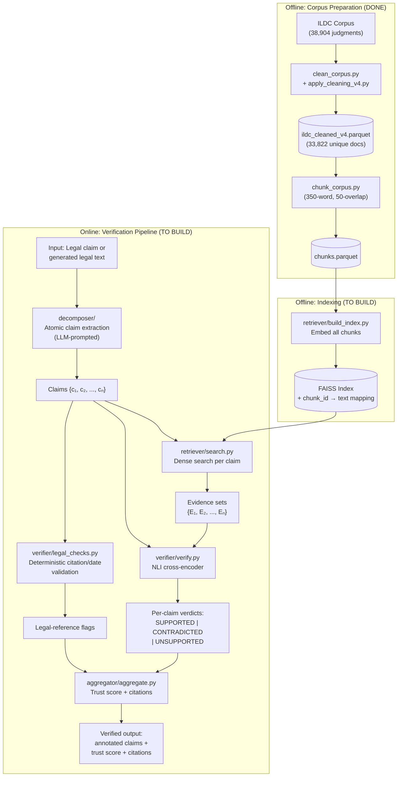

# VeriRAG — Complete Research Plan

> **Status**: Planning-only. No code changes proposed. Awaiting approval before any implementation.
> **Date**: 2026-10-26
> **Scope**: NLP course-end project — legal hallucination detection and evidence verification for Indian court judgments.

---

## Table of Contents

1. [Deliverable 1: Repository Audit](#deliverable-1-repository-audit)
2. [Deliverable 2: Research Specification](#deliverable-2-research-specification)
3. [Deliverable 3: Proposed Architecture](#deliverable-3-proposed-architecture)
4. [Deliverable 4: Dataset and Annotation Specification](#deliverable-4-dataset-and-annotation-specification)
5. [Deliverable 5: Experimental Protocol](#deliverable-5-experimental-protocol)
6. [Deliverable 6: Technical Decision Matrix](#deliverable-6-technical-decision-matrix)
7. [Deliverable 7: Milestone Plan](#deliverable-7-milestone-plan)
8. [Deliverable 8: Risks and Unresolved Decisions](#deliverable-8-risks-and-unresolved-decisions)
9. [Deliverable 9: Definition of Done](#deliverable-9-definition-of-done)
10. [Final Recommendations](#final-recommendations)

---

## Deliverable 1: Repository Audit

### 1.1 Verified, Implemented, and Tested Components

| Component | Files | Evidence of Execution | Confidence |
|:---|:---|:---|:---|
| **Project scaffolding** | `README.md`, `ARCHITECTURE.md`, `definitions.md`, `.gitignore`, `requirements.txt` | Git commit `1ab944b` | ✅ Verified |
| **HF dataset loading** | [`data/load_ildc.py`](file:///c:/Users/Zainab%20Motiwala/Documents/verirag/data/load_ildc.py) | Loads 3 datasets; includes `load_cleaned_corpus()` for parquet. Commit `c3b51f4`. | ✅ Verified |
| **Corpus inspection** | [`data/inspect_corpus.py`](file:///c:/Users/Zainab%20Motiwala/Documents/verirag/data/inspect_corpus.py) | Interactive explorer. Commit `c3b51f4`. | ✅ Verified |
| **Corpus cleaning engine** | [`data/clean_corpus.py`](file:///c:/Users/Zainab%20Motiwala/Documents/verirag/data/clean_corpus.py) (387 lines) | Dictionary-driven token reconstruction with `wordfreq` + NLTK, space-splitting, LRU-caching, low-confidence guardrail. Has `__main__` self-test. Commits `9398c3c`→`2bea039`. | ✅ Verified |
| **Production cleaning pipeline** | [`data/apply_cleaning_v4.py`](file:///c:/Users/Zainab%20Motiwala/Documents/verirag/data/apply_cleaning_v4.py) (370 lines) | Multi-process (6 CPUs, batch 300), saves `ildc_cleaned_v4.parquet`, performs round-trip QA, exports reports. | ✅ Verified |
| **Cleaning audit** | [`data/audit_cleaning.py`](file:///c:/Users/Zainab%20Motiwala/Documents/verirag/data/audit_cleaning.py) (236 lines) | Side-by-side comparison, residual scans, full-corpus QA. | ✅ Verified |
| **Deduplication** | [`data/run_step_b.py`](file:///c:/Users/Zainab%20Motiwala/Documents/verirag/data/run_step_b.py) | Deduplicates 38,904 → 33,822 unique judgments. Asserts byte-identical duplicates. | ✅ Verified |
| **Negation repair scoring** | [`data/negation_repair.py`](file:///c:/Users/Zainab%20Motiwala/Documents/verirag/data/negation_repair.py) (284 lines) | Deterministic rules + InLegalBERT MLM for standalone `number` → `{not,nor,now,non,no,number}`. Shard-resumable. | ✅ Code verified |
| **MLM self-supervised validation** | [`data/run_step_c.py`](file:///c:/Users/Zainab%20Motiwala/Documents/verirag/data/run_step_c.py) (460 lines) | 6,000-sample validation: 87.2% accuracy. 150-item real-data audit: 98.0% agreement. Confusion matrix, confidence thresholds. | ✅ Verified via `mlm_validation_summary.json` |
| **MLM annotation artifacts** | `data/reports/` (9 files) | `gold_number_150.csv`, `gold_number_200_blind.csv`, `gold_labeling_guide.md`, `audit_4_candidates.json`, `audit_4_final_annotations.json`, `mlm_validation_summary.json`, `step_b_and_c_results.json` | ✅ Verified |
| **Sentence-aware chunker** | [`retriever/chunk_corpus.py`](file:///c:/Users/Zainab%20Motiwala/Documents/verirag/retriever/chunk_corpus.py) (372 lines) | Legal-abbreviation-safe sentence splitting, ~350 words with ~50-word overlap, character-offset tracking. Multi-process. Commit `8390ac1`. | ✅ Verified |
| **Legacy cleaning scripts** | `data/apply_cleaning.py`, `_v2.py`, `_v3.py` | Historical iterations; superseded by v4. | ✅ Present |
| **Step B/C analysis** | [`data/run_step_bc_analysis.py`](file:///c:/Users/Zainab%20Motiwala/Documents/verirag/data/run_step_bc_analysis.py) | Roman numeral analysis, excluded-context residual scanning. | ✅ Verified |

### 1.2 Unverified Runtime Artifacts

| Artifact | Expected Location | Status |
|:---|:---|:---|
| `ildc_cleaned_v4.parquet` | `data/processed/` | **Not in Git** (`.gitignore` excludes `*.parquet`). Must be regenerated or exist locally. |
| `ildc_v4_dedup.parquet` | `data/processed/` | Same — not in Git. |
| `chunks.parquet` | `data/processed/` | Same — not in Git. |
| `number_occurrences.parquet` | `data/processed/negation/` | Same — not in Git. Colab instructions reference it. |
| `number_scores.parquet` | `data/processed/negation/` | Same — Colab GPU job output. |
| `.env` with `HF_TOKEN` | Project root | Required for `Exploration-Lab/IL-TUR`. Not verified. |

> [!IMPORTANT]
> None of the intermediate parquet files are tracked in Git. Before any downstream work, we must confirm which ones exist locally and which need regenerating. The chunking pipeline requires `ildc_cleaned_v4.parquet`; all downstream modules require `chunks.parquet`.

### 1.3 Empty Placeholder Directories (`.gitkeep` only)

| Directory | Planned Role | Implementation Status |
|:---|:---|:---|
| `generator/` | LLM answer/judgment generation | 🚫 Empty |
| `decomposer/` | Atomic claim extraction | 🚫 Empty |
| `verifier/` | NLI claim verification | 🚫 Empty |
| `aggregator/` | Trust scoring & citation linking | 🚫 Empty |
| `eval/` | Benchmark evaluation suite | 🚫 Empty |
| `notebooks/` | EDA & prototyping | 🚫 Empty |

### 1.4 Configuration Status

[`configs/config.yaml`](file:///c:/Users/Zainab%20Motiwala/Documents/verirag/configs/config.yaml) contains **only TODO placeholders**. Every value is a string like `"TODO: e.g. ..."`. No operational configuration exists.

### 1.5 Technical Debt and Issues

| Issue | Severity | Location |
|:---|:---|:---|
| `config.yaml` is non-functional — all values are TODO strings | **High** | `configs/config.yaml` |
| Chunk size in words not tokens — mismatch with actual model tokenizer | **Medium** | `retriever/chunk_corpus.py` L9-11 |
| No `__init__.py` in any module → not importable as packages | **Medium** | All directories |
| `requirements.txt` lists `anthropic` but no OpenAI SDK | **Low** | `requirements.txt` |
| Colab instructions reference `c:/Users/Saniya Gharat/...` — stale path | **Low** | `data/processed/negation/RUN_ON_COLAB.md` |
| `negation_repair.py` accesses `model.bert` directly (fragile) | **Low** | `data/negation_repair.py` L189 |
| No Python packaging (`setup.py`, `pyproject.toml`) | **Low** | Root |

### 1.6 What to Reuse, Modify, Replace, or Defer

| Decision | Components |
|:---|:---|
| **Reuse as-is** | `clean_corpus.py`, `apply_cleaning_v4.py`, `audit_cleaning.py`, `load_ildc.py`, `inspect_corpus.py`, `definitions.md`, all `data/reports/` artifacts |
| **Reuse with minor modifications** | `chunk_corpus.py` (may need token-based sizing), `negation_repair.py` (only if negation repair is applied before indexing) |
| **Replace** | `config.yaml` (rewrite with actual values) |
| **Defer** | Legacy cleaning scripts (`apply_cleaning.py`, `_v2.py`, `_v3.py`), `run_step_b.py` / `run_step_bc_analysis.py` (archival only), Colab guide |

---

## Deliverable 2: Research Specification

### 2.1 Problem Statement

Legal NLP systems that generate answers about court judgments risk producing claims that are factually unsupported by or contradicted by the source documents. Standard RAG architectures provide no structured mechanism to verify individual claims against retrieved evidence or to quantify the trustworthiness of generated responses at a granular level.

### 2.2 Research Question

**RQ**: Does decomposing generated legal text into atomic claims and independently verifying each claim against retrieved evidence using NLI improve the detection of unsupported or contradicted assertions, compared to response-level or lexical verification baselines?

### 2.3 Hypotheses

- **H1 (Primary)**: Claim-level NLI verification achieves higher macro-F1 for detecting `UNSUPPORTED` and `CONTRADICTED` claims than a lexical-overlap baseline operating on the same evidence.
- **H2**: Adding deterministic legal-reference checks (case citation format, date validation, section number verification) improves precision for `CONTRADICTED` labels on claims containing legal identifiers, compared to NLI alone.
- **H3**: Claim decomposition improves verification granularity — a system that decomposes before verifying detects more unsupported sub-claims than one that verifies at the sentence level.

### 2.4 Proposed Contributions

#### Primary Contribution
**Claim-level verification pipeline for Indian legal text with empirical evaluation.** The contribution is not the individual techniques (NLI, claim decomposition, retrieval) — all are established. The contribution is the integrated pipeline evaluated on a domain-specific (Indian legal) benchmark with a manually annotated claim–evidence dataset, providing empirical evidence about whether decomposed verification outperforms baselines in this domain.

> [!WARNING]
> This contribution is defensible only if accompanied by a properly annotated evaluation set and rigorous baselines. Without these, it reduces to "we combined existing tools" — which is not a contribution.

#### Secondary Contributions (at most two)
1. **Corpus hygiene methodology for ILDC**: Documented and audited cleaning pipeline for systematic corruption in a widely-used legal NLP corpus (already partially completed in the repository).
2. **Diagnostic analysis of NLI model behavior on legal evidence**: Error analysis characterizing failure modes (legal jargon, temporal reasoning, nested citations) of general-domain NLI models on legal text.

### 2.5 Scope

**In scope**:
- English-language Indian Supreme Court judgments (ILDC corpus)
- Claim decomposition of generated legal text
- NLI-based claim verification against retrieved evidence
- Deterministic legal-reference validation
- Manual annotation of 300–500 claim–evidence pairs
- Ablation experiments

**Out of scope**:
- Training custom NLI models from scratch
- Multilingual or vernacular legal text
- Real-time production deployment
- Knowledge graph construction
- Full CJPE (Court Judgment Prediction and Explanation) benchmarking

### 2.6 Limitations

- Evaluation set is small (300–500 examples) and annotated by project team — not an established community benchmark.
- Generated text comes from API-based LLMs whose behavior may change over time.
- ILDC expert set (54 cases) provides only judgment-level explanations, not claim-level verification labels.
- Results are specific to Indian Supreme Court text and may not generalize to other legal traditions.

---

## Deliverable 3: Proposed Architecture

### 3.1 Minimum Viable Research System

The smallest complete system that can test the research question requires:



### 3.2 Component-Level Data Flow

| Step | Input | Output | Provenance |
|:---|:---|:---|:---|
| **1. Chunk embedding** | `chunks.parquet` (text, chunk_id, doc_id, char_start, char_end) | FAISS index + metadata lookup dict | chunk_id traces to doc_id + character offsets |
| **2. Claim decomposition** | Raw legal text (generated or input) | List of `{claim_text, claim_index, source_sentence}` | `source_sentence` links back to original text |
| **3. Retrieval** | Claim text → query embedding | Top-k `{chunk_id, doc_id, score, text}` per claim | chunk_id → doc_id → corpus provenance |
| **4. NLI verification** | (claim_text, evidence_text) pairs | `{label, confidence}` per pair | Inherits provenance from both claim and evidence |
| **5. Legal-reference checks** | claim_text | `{check_type, status, details}` | Deterministic — traceable by regex pattern |
| **6. Aggregation** | Per-claim labels + confidences + legal flags | `{overall_trust_score, per_claim_detail, citations}` | Full chain: claim → evidence → verdict → score |

### 3.3 Evidence Traceability

Every verification result carries:
- `claim_index` → position in decomposed output
- `evidence_chunk_id` → specific passage in `chunks.parquet`
- `evidence_doc_id` → original judgment ID in ILDC
- `evidence_char_span` → `[char_start:char_end]` in `text_cleaned`
- `nli_label` + `nli_confidence` → model output
- `legal_check_results` → deterministic validation flags

### 3.4 What Is Essential vs. Deferrable

| Component | Essential for Research | Deferrable |
|:---|:---|:---|
| FAISS index + dense retrieval | ✅ Yes | — |
| Claim decomposition (LLM-prompted) | ✅ Yes | — |
| NLI cross-encoder verification | ✅ Yes | — |
| Legal-reference deterministic checks | ✅ Yes (for H2) | — |
| Aggregation (simple scoring) | ✅ Yes (minimal) | Sophisticated weighted schemes |
| LLM text generation | ⚠️ Partially | Can use pre-generated text |
| BM25 retrieval | ⚠️ Useful as baseline | Can defer if time-limited |
| Web UI | — | ✅ Fully deferrable |
| Docker / CI/CD | — | ✅ Fully deferrable |
| Knowledge graph | — | ✅ Fully deferrable |

---

## Deliverable 4: Dataset and Annotation Specification

### 4.1 Existing Dataset Assessment

#### ILDC_35k_COMPLETE (`jayadityagandham9/ILDC_35k_COMPLETE`)

| Property | Status |
|:---|:---|
| Availability | Public on Hugging Face, no gating |
| Schema | Fields: `id` (str), `text` (str), `label` (int: 0/1) |
| Size | 38,904 rows (33,822 unique after dedup) |
| Task | Binary judgment prediction (accepted/rejected) |
| Language | English |
| Corruption | Systematic `Co.`→`company`, `No.`→`number` regex artifacts — **addressed by cleaning pipeline** |
| Suitability for VeriRAG | ✅ Good as retrieval corpus. ❌ Does **not** provide claim-level or hallucination labels. |

#### ILDC_expert (`anuragiiser/ILDC_expert`)

| Property | Status |
|:---|:---|
| Availability | Public on Hugging Face |
| Size | 54 examples |
| Annotations | Human expert explanations (gold-standard reasoning for judgment predictions) |
| Suitability | ⚠️ Useful for qualitative comparison only. Explanations are judgment-level, not claim-level. **Not suitable as a claim-verification benchmark.** |

> [!IMPORTANT]
> **Fact requiring verification**: The exact schema of `ILDC_expert` (field names, explanation format, whether explanations cite specific passages) must be inspected at runtime before relying on it for evaluation. The 54-case size is too small for statistical significance on its own.

#### IL-TUR / CJPE (`Exploration-Lab/IL-TUR`)

| Property | Status |
|:---|:---|
| Availability | **Gated** — requires HF token + terms acceptance |
| Task | Court Judgment Prediction and Explanation |
| Suitability | ⚠️ Potentially useful for end-to-end evaluation, but: (1) access must be verified, (2) task alignment with claim verification is indirect, (3) may duplicate ILDC cases — **data leakage risk**. |

> [!WARNING]
> **Facts requiring verification before use:**
> - Whether IL-TUR cases overlap with ILDC_35k (leakage risk).
> - Whether CJPE explanations can be decomposed into verifiable claims.
> - Exact license terms and permitted derivative works.

### 4.2 Custom Claim–Evidence Benchmark (VeriRAG-Bench)

Since no existing dataset provides claim-level hallucination labels for Indian legal text, we must create a small benchmark.

#### 4.2.1 Target Size
**300–500 labelled (claim, evidence, verdict) triples**, drawn from ≥ 30 distinct judgments.

#### 4.2.2 Label Definitions

| Label | Code | Definition | Decision Rule |
|:---|:---|:---|:---|
| **Supported** | `SUP` | Evidence directly and unambiguously confirms the claim. Every essential entity, date, and legal holding matches. | A competent reader can infer the claim's truth from the evidence alone, without external knowledge. |
| **Contradicted** | `CON` | Evidence directly refutes the claim — presents a mutually exclusive fact. | The evidence explicitly asserts the negation or an incompatible state (different date, opposite outcome, wrong party). |
| **Not Established** | `NEI` | Evidence is silent, ambiguous, or insufficient to confirm or refute the claim. | The evidence lacks critical elements needed to verify the claim, or is about a different matter. |

> [!NOTE]
> We use `NEI` (Not Enough Information / Not Established) rather than `UNSUPPORTED` to better align with FEVER-style label conventions and to signal that the label reflects insufficient evidence rather than a judgment that the claim is false.

#### 4.2.3 Claim Types to Include

| Type | Example | Min. Count |
|:---|:---|:---|
| Factual holding | "The Supreme Court dismissed the appeal." | 80 |
| Legal citation | "Under Section 302 of the IPC..." | 60 |
| Date/timeline | "The petition was filed on 12 March 2019." | 40 |
| Party identification | "The appellant was M/s XYZ Ltd." | 30 |
| Procedural history | "The High Court had earlier stayed the order." | 40 |
| Legal principle | "The right to privacy is a fundamental right under Article 21." | 30 |
| Fabricated/hallucinated | Deliberately incorrect claims | 50 |

#### 4.2.4 Annotation Protocol

1. **Source selection**: Sample 30–50 judgments from ILDC, stratified by text length (short/medium/long) and label (accepted/rejected).
2. **Claim generation**: For each judgment, generate 5–15 claims using the LLM generator, plus 2–5 manually crafted incorrect claims.
3. **Evidence retrieval**: For each claim, run retrieval to obtain top-5 evidence chunks. Present the top-3 to annotators.
4. **Annotation**: Each (claim, evidence_set) pair is labelled `SUP`, `CON`, or `NEI` by **two independent annotators**.
5. **Disagreement resolution**: Third annotator adjudicates disagreements. If all three disagree, label as `AMBIGUOUS` and exclude from primary metrics.
6. **Inter-annotator agreement**: Report Cohen's κ on the two-annotator pass before adjudication.

#### 4.2.5 Handling Special Cases

| Scenario | Protocol |
|:---|:---|
| Insufficient evidence retrieved | Label as `NEI` — this is a retrieval failure, not an annotation ambiguity. |
| Irrelevant evidence | Label as `NEI` — irrelevant evidence cannot support or contradict. |
| Conflicting evidence across chunks | Annotate based on the **majority evidence**. Flag the conflict in metadata. |
| Legal citation format correct but case doesn't exist | Label the citation claim as `CON` if verifiable as fabricated, else `NEI`. |
| Partially correct (right case, wrong date) | Label as `CON` — partial correctness with a factual error is contradiction. |

#### 4.2.6 Data Leakage Controls

- **Judgment-level split**: All claims from a single judgment appear in exactly one split (train/dev/test).
- **No overlap**: Judgments used for benchmark creation must not overlap with any judgments used to develop or tune the decomposer/verifier prompts.
- **Temporal awareness**: Document the ILDC version and HF dataset commit hash used.

#### 4.2.7 Annotator Agreement Targets

- **Minimum acceptable Cohen's κ**: 0.65 (substantial agreement)
- **Target**: ≥ 0.75

---

## Deliverable 5: Experimental Protocol

### Experiment A: Verification Baseline

| Element | Specification |
|:---|:---|
| **Hypothesis** | A pretrained NLI cross-encoder outperforms lexical-overlap baselines at classifying claim–evidence pairs into SUP/CON/NEI. |
| **Baselines** | (1) ROUGE-L between claim and evidence (threshold-based), (2) BM25 score (threshold-based), (3) Sentence embedding cosine similarity (threshold-based) |
| **Independent variable** | Verification method (NLI vs. baselines) |
| **Dataset** | VeriRAG-Bench test split (~100–150 examples) |
| **Metrics** | Macro-F1, per-class precision/recall, false-supported rate (claims labelled SUP that are actually CON or NEI) |
| **Compute** | CPU-feasible for NLI cross-encoder; ~2 hours for full test set |
| **Threats** | (1) Small test set limits statistical power, (2) NLI model may be biased toward SUP on long legal passages, (3) Baseline thresholds require tuning on dev set |
| **Conclusions supported** | Whether NLI improves verification over surface-level methods *on this specific dataset*. NOT generalizable claims about NLI superiority in all legal domains. |

### Experiment B: Legal-Reference Validation

| Element | Specification |
|:---|:---|
| **Hypothesis** | Deterministic checks for legal references (case citation format, section numbers, dates) improve precision for CON labels on reference-containing claims compared to NLI alone. |
| **Baseline** | NLI-only verification |
| **Independent variable** | Presence/absence of legal-reference checker |
| **Dataset** | Subset of VeriRAG-Bench containing legal references (~60–80 examples) |
| **Metrics** | Precision for CON label, recall for CON label, overall F1 on reference-containing claims |
| **Compute** | Negligible (regex-based) |
| **Threats** | (1) Small reference-containing subset, (2) Deterministic checks may have low recall for novel citation formats, (3) Confound if NLI already handles references well |
| **Conclusions supported** | Whether deterministic checks *add value beyond* NLI for structured legal identifiers. |

### Experiment C: Ablation Study

| Element | Specification |
|:---|:---|
| **Hypothesis** | Each pipeline component (claim decomposition, NLI, legal checks) contributes to overall verification quality — removing any one degrades performance. |
| **Configurations** | (1) Full pipeline, (2) No decomposition (verify at sentence level), (3) No NLI (lexical only + legal checks), (4) No legal checks (NLI only), (5) No decomposition + no NLI (lexical at sentence level) |
| **Dataset** | VeriRAG-Bench test split |
| **Metrics** | Macro-F1, unsupported-claim recall (sensitivity to NEI), false-supported rate |
| **Compute** | 5× the single-run cost (~10 hours total) |
| **Threats** | (1) Five-way comparison on small dataset risks noise, (2) Decomposition quality confounds NLI evaluation |
| **Conclusions supported** | Relative contribution of each component. NOT optimal parameter settings. |

### Experiment D: Evidence Robustness

| Element | Specification |
|:---|:---|
| **Hypothesis** | The system's verification labels degrade gracefully (i.e., shift toward NEI rather than false SUP) when evidence quality is degraded. |
| **Conditions** | (1) Gold evidence (manually selected best passage), (2) Top-1 retrieval, (3) Top-5 retrieval, (4) Random evidence (negative control), (5) Empty evidence |
| **Dataset** | Subset of VeriRAG-Bench (~80–100 SUP examples with gold evidence) |
| **Metrics** | Distribution of predicted labels across conditions, false-supported rate under random/empty evidence |
| **Compute** | ~4 hours |
| **Threats** | (1) "Gold evidence" selection may be subjective, (2) NLI models may predict NEI by default on short/empty evidence, trivially passing the test |
| **Conclusions supported** | Whether the system avoids false support under adversarial evidence conditions. |

### Experiment E: End-to-End Evaluation

| Element | Specification |
|:---|:---|
| **Hypothesis** | The full verified pipeline produces more trustworthy outputs (fewer unsupported claims) than unverified RAG on a fixed set of legal questions. |
| **Setup** | 20–30 legal questions → RAG generates answers → pipeline verifies → manual assessment |
| **Comparison** | (1) Unverified RAG response, (2) Verified RAG response with claim annotations |
| **Dataset** | 20–30 manually crafted questions about ILDC judgments |
| **Metrics** | Claim accuracy (manual), abstention rate, citation correctness, qualitative assessment |
| **Compute** | LLM API costs for generation (~$5–20) |
| **Threats** | (1) Very small sample, (2) Manual assessment is subjective, (3) LLM generation quality confounds verification quality |
| **Conclusions supported** | Qualitative and directional evidence only. NOT statistically significant claims about pipeline superiority. |

> [!NOTE]
> Experiments A–D are essential. Experiment E is strongly recommended but can be scaled down if time is limited.

---

## Deliverable 6: Technical Decision Matrix

### 6.1 Retrieval

| Option | Model ID | Use | CPU Compatible | Size | License | Domain Fit | Recommendation |
|:---|:---|:---|:---|:---|:---|:---|:---|
| **BM25 (rank-bm25)** | N/A (library) | Sparse baseline retrieval | ✅ Yes | Negligible | MIT | Generic but effective baseline | ✅ Use as baseline |
| **all-MiniLM-L6-v2** | `sentence-transformers/all-MiniLM-L6-v2` | Dense embedding | ✅ Yes | 80 MB | Apache 2.0 | General-purpose; fast | ✅ Recommended primary |
| **all-mpnet-base-v2** | `sentence-transformers/all-mpnet-base-v2` | Dense embedding | ✅ Yes (slower) | 420 MB | Apache 2.0 | Higher quality, slower | ⚠️ Alternative if quality insufficient |
| **InLegalBERT** | `law-ai/InLegalBERT` | Dense embedding | ✅ Yes | 440 MB | MIT | Pre-trained on Indian legal text | ⚠️ Not a sentence-transformer; needs fine-tuning or mean-pooling adapter. **Requires verification** |

> [!IMPORTANT]
> **Fact requiring verification**: `law-ai/InLegalBERT` is a BERT-base model, not a sentence-transformer. Using it for dense retrieval requires either (a) wrapping with mean-pooling, or (b) fine-tuning as a bi-encoder. Its effectiveness for passage retrieval vs. a dedicated sentence-transformer is **unknown** and must be tested empirically.

### 6.2 NLI Cross-Encoders

| Option | Model ID | Use | CPU Compatible | Size | License | Domain Fit | Recommendation |
|:---|:---|:---|:---|:---|:---|:---|:---|
| **DeBERTa-v3-large NLI** | `cross-encoder/nli-deberta-v3-large` | Claim–evidence NLI | ⚠️ Slow on CPU | 1.4 GB | MIT | SOTA general NLI | ✅ Primary verifier |
| **DeBERTa-v3-base NLI** | `cross-encoder/nli-deberta-v3-base` | Claim–evidence NLI | ✅ Feasible | 440 MB | MIT | Strong general NLI | ✅ Recommended if CPU-constrained |
| **MiniLM NLI** | `cross-encoder/nli-MiniLM2-L6-H768` | Fast NLI | ✅ Fast | 80 MB | Apache 2.0 | Good speed/quality tradeoff | ⚠️ Smaller; useful for dev |

### 6.3 Claim Decomposition

| Option | Use | Cost | Quality | Recommendation |
|:---|:---|:---|:---|:---|
| **Claude API (claude-3-5-sonnet)** | LLM-prompted decomposition | ~$0.003/claim | High | ✅ Recommended (already in `requirements.txt`) |
| **GPT-4o-mini API** | LLM-prompted decomposition | ~$0.0004/claim | Good | ⚠️ Alternative — cheaper |
| **Rule-based (spaCy + regex)** | Sentence splitting + heuristics | Free | Low | ⚠️ Ablation baseline only |

### 6.4 Generation (Optional)

| Option | Use | Cost | Recommendation |
|:---|:---|:---|:---|
| **Claude API** | Generate legal analysis text for verification | ~$0.01/response | ✅ Already in stack |
| **Pre-generated static set** | Skip generation; use fixed test questions | Free | ✅ Recommended for reproducibility |

### 6.5 FAISS Configuration

| Option | Build Time | Query Time | Memory | Recommendation |
|:---|:---|:---|:---|:---|
| **Flat-IP (exact)** | Fast | O(n) | ~1–2 GB for 200k chunks | ✅ Recommended — corpus is small enough |
| **IVF + PQ** | Slower build | Faster query | Lower | ⚠️ Only needed if query latency is a problem |
| **HNSW** | Slow build | Very fast query | High | ⚠️ Overkill for this corpus size |

### 6.6 Evaluation & Metrics Libraries

| Library | Use | Recommendation |
|:---|:---|:---|
| `scikit-learn` | Classification metrics (F1, precision, recall, confusion matrix) | ✅ Already in requirements |
| `datasets` (HF) | Data loading and management | ✅ Already in requirements |
| `pandas` | Data manipulation and analysis | ✅ Already in requirements |
| `matplotlib` / `seaborn` | Visualization (optional, for paper figures) | ⚠️ Add if needed |

### 6.7 UI

| Option | Recommendation |
|:---|:---|
| **Gradio** | ✅ Lightweight, 1-file demo — if UI is desired |
| **Streamlit** | ⚠️ Alternative |
| **No UI** | ✅ Acceptable for course project — CLI + notebook demo is sufficient |

---

## Deliverable 7: Milestone Plan

### Milestone 0: Verify Local Data State *(~0.5 day)*

| Task | Dependency | Deliverable | Acceptance | Test | Risk | Effort |
|:---|:---|:---|:---|:---|:---|:---|
| Confirm existence of `ildc_cleaned_v4.parquet` locally | None | File path confirmation | File exists, row count = 38,904 (or 33,822 if deduped) | `wc -l` equivalent, schema check | May need to regenerate (~30 min on 6 CPUs) | 1h |
| Confirm existence of `chunks.parquet` locally | Parquet exists | File path confirmation | File exists, has `chunk_id`, `doc_id`, `text`, `word_count`, `char_start`, `char_end` | Schema validation | May need to regenerate (~15 min) | 1h |
| Decide: use v4 (38,904) or deduped (33,822) going forward | Parquet exists | Decision recorded in config | Config updated | N/A | Inconsistency between modules if not decided now | 0.5h |

**Gate**: Parquet files confirmed. Proceed only after this.

---

### Milestone 1: Retrieval Index *(~2–3 days)*

| Task | Dependency | Deliverable | Acceptance | Test | Risk | Effort |
|:---|:---|:---|:---|:---|:---|:---|
| Implement `retriever/embed_chunks.py` | `chunks.parquet` | Embeddings array + metadata dict | All chunks embedded; round-trip shape check | Embed 100 chunks, verify shape | Embedding model download time; OOM on large batch | 4h |
| Implement `retriever/build_index.py` | Embeddings | FAISS Flat-IP index file | Index loads successfully; `.ntotal` == chunk count | Load and query 3 test claims | FAISS index size (~1-2 GB) | 3h |
| Implement `retriever/search.py` | Index file | Function: `search(query, top_k) → results` | Returns correct chunk_ids and scores | Query with known judgment text, verify top-1 is from same doc | Embedding model mismatch | 3h |
| Implement BM25 baseline retrieval | `chunks.parquet` | Function: `bm25_search(query, top_k) → results` | Returns results | Same test as above | None significant | 2h |
| Populate `config.yaml` retriever section | All above | Working config | Scripts load config correctly | Config parsing test | None | 1h |

**Acceptance criteria**: Given a query containing text from a known judgment, retrieval returns chunks from that judgment in the top-5. BM25 baseline functional.

---

### Milestone 2: Claim Decomposition *(~2–3 days)*

| Task | Dependency | Deliverable | Acceptance | Test | Risk | Effort |
|:---|:---|:---|:---|:---|:---|:---|
| Design decomposition prompt based on `definitions.md` | `definitions.md` | Prompt template file | Produces atomic claims matching definition criteria | Test on 5 example sentences from `definitions.md` | Prompt iteration needed | 4h |
| Implement `decomposer/decompose.py` | Prompt + API key | Function: `decompose(text) → list[claim]` | Claims are atomic, coreference-resolved, single-predicate | Run on 10 legal sentences, manually verify | API cost; rate limits | 4h |
| Implement rule-based baseline | None | Function: `decompose_baseline(text) → list[sentence]` | Splits at sentence boundaries | Compare count vs LLM decomposition | Naive splitting; lower quality | 2h |
| Test on ILDC expert examples | Decompose function | 10 decomposed expert texts | Manual quality review | Side-by-side comparison | None | 3h |
| Populate `config.yaml` decomposer section | All above | Working config | — | — | — | 0.5h |

**Acceptance criteria**: Decomposition produces claims that meet the atomicity criteria in `definitions.md` on ≥ 80% of tested sentences (manual review).

---

### Milestone 3: Claim Verification *(~3–4 days)*

| Task | Dependency | Deliverable | Acceptance | Test | Risk | Effort |
|:---|:---|:---|:---|:---|:---|:---|
| Implement `verifier/nli_verify.py` | NLI model | Function: `verify(claim, evidence) → {label, score}` | Returns SUP/CON/NEI with calibrated scores | Test on 10 manually crafted (claim, evidence) pairs | Model download (~1.4 GB); CPU inference speed | 4h |
| Implement `verifier/legal_checks.py` | None | Function: `check_references(claim) → list[flag]` | Detects citation patterns, dates, section numbers | Test on 15 claims with/without references | Regex coverage for Indian legal citation styles | 6h |
| Implement threshold calibration script | NLI function + dev set | Threshold values in config | Thresholds maximize F1 on dev set | Cross-validation on dev set | Small dev set → unstable thresholds | 3h |
| Implement `verifier/verify_pipeline.py` | NLI + legal checks | Combined function: `verify_claim(claim, evidence_set) → verdict` | Combines NLI and legal checks | Run on 20 example pairs | Integration complexity | 3h |
| Populate `config.yaml` verifier section | All above | Working config | — | — | — | 0.5h |

**Acceptance criteria**: Verifier produces reasonable labels on manually reviewed examples. NLI inference completes in < 2 seconds per (claim, evidence) pair on CPU.

---

### Milestone 4: Aggregation *(~1–2 days)*

| Task | Dependency | Deliverable | Acceptance | Test | Risk | Effort |
|:---|:---|:---|:---|:---|:---|:---|
| Implement `aggregator/aggregate.py` | Verifier output | Function: `aggregate(claim_verdicts) → {trust_score, detail}` | Produces score ∈ [0,1] and per-claim breakdown | Test on synthetic verdict lists | None significant | 3h |
| Implement citation linking | Chunk metadata | Function: add `doc_id`, `char_span` to each verdict | Every SUP/CON verdict has a traceable citation | Verify on 5 examples | None | 2h |
| Implement output formatter | Aggregation + citations | JSON/Markdown output of verified response | Human-readable output with claim annotations | Manual review | None | 2h |

**Acceptance criteria**: End-to-end pipeline (decompose → retrieve → verify → aggregate) runs on a single legal question and produces annotated output with citations.

---

### Milestone 5: Benchmark Annotation *(~5–7 days)*

| Task | Dependency | Deliverable | Acceptance | Test | Risk | Effort |
|:---|:---|:---|:---|:---|:---|:---|
| Select 30–50 source judgments | Cleaned corpus | Judgment IDs with stratification metadata | Covers short/medium/long texts, both labels | Distribution check | Sampling bias | 2h |
| Generate claims per judgment | Decomposer + optional LLM | 300–500 claims total | Mix of factual, citation, date, fabricated | Count check | LLM may produce low-quality claims | 8h |
| Retrieve evidence per claim | Retriever | Top-3 evidence per claim | All claims have evidence attached | Spot check 20 | Retrieval failures | 4h |
| Annotate (2 annotators) | Claims + evidence | 300–500 labelled triples | Each triple has two independent labels | Agreement check | Low agreement | 16h |
| Resolve disagreements | Annotations | Final gold labels | Cohen's κ ≥ 0.65 pre-adjudication | κ calculation | Insufficient agreement | 4h |
| Split into dev/test by judgment | Gold labels | Dev (~100) + Test (~200–400) | No judgment overlap between splits | Overlap check | Unbalanced splits | 1h |

**Acceptance criteria**: Gold-labelled dataset with κ ≥ 0.65, judgment-level splits, minimum 300 examples.

---

### Milestone 6: Experiments and Analysis *(~5–7 days)*

| Task | Dependency | Deliverable | Acceptance | Test | Risk | Effort |
|:---|:---|:---|:---|:---|:---|:---|
| Implement `eval/run_experiments.py` | All pipeline components + benchmark | Experiment runner with config | Reproduces results from single command | Re-run and verify identical output | Non-determinism in LLM calls | 6h |
| Run Experiment A (NLI vs baselines) | Runner + test set | Results table + analysis | Metrics computed for all conditions | Sanity check: random baseline < NLI | NLI may not outperform on legal text | 4h |
| Run Experiment B (legal checks) | Runner + reference subset | Results table | Precision comparison computed | Manual verification of 10 legal-check examples | Small reference subset | 3h |
| Run Experiment C (ablation) | Runner + all configs | Ablation table | 5 configurations tested | Cross-check component contributions | Combinatorial cost | 6h |
| Run Experiment D (robustness) | Runner + SUP subset | Label distribution analysis | 5 evidence conditions tested | False-SUP rate under random evidence = low | Trivial NEI predictions | 3h |
| Run Experiment E (end-to-end) | Full pipeline + 20–30 questions | Qualitative analysis | Manual assessment completed | At least 2 reviewers | Subjective; time-consuming | 8h |
| Error analysis | All results | Error taxonomy document | ≥ 20 failure cases categorized | Manual review | None | 4h |

**Acceptance criteria**: All five experiments produce reportable results with proper metrics, baselines, and error analysis.

---

### Milestone 7: Documentation and Submission *(~2–3 days)*

| Task | Dependency | Deliverable | Acceptance | Test | Risk | Effort |
|:---|:---|:---|:---|:---|:---|:---|
| Update `README.md` with final instructions | All milestones | Comprehensive README | New user can run the pipeline from README | Dry-run by team member | None | 3h |
| Update `ARCHITECTURE.md` | All milestones | Reflects actual implementation | Matches code reality | Cross-reference with codebase | Documentation drift | 2h |
| Write project report/paper | All results | Course report | Follows required format | Peer review | Writing quality | 12h |
| Create demo notebook | Full pipeline | `notebooks/demo.ipynb` | Runs end-to-end on 1 example | Execute notebook | Dependency issues | 3h |

---

### Optional Extensions (Post-Core)

| Extension | Prerequisite | Effort | Value |
|:---|:---|:---|:---|
| Gradio demo UI | Milestone 4 | 4h | Medium — good for presentation |
| BM25 + dense hybrid retrieval | Milestone 1 | 4h | Medium — may improve retrieval |
| Fine-tune NLI on legal NLI data | Milestone 3 | 16h+ | High but risky — requires training data |
| Negation-repair integration into main pipeline | Existing scripts | 3h | Low — corpus cleaning is already strong |

---

## Deliverable 8: Risks and Unresolved Decisions

### 8.1 Decisions Requiring Your Approval

| # | Decision | Options | My Recommendation | Impact |
|:---|:---|:---|:---|:---|
| **D1** | Use deduplicated corpus (33,822) or full (38,904) for indexing? | (a) Dedup, (b) Full | **(a) Dedup** — avoids duplicate chunks polluting retrieval | Affects index size, retrieval quality |
| **D2** | Primary embedding model for retrieval? | (a) MiniLM-L6, (b) MPNet-base, (c) InLegalBERT with mean-pooling | **(a) MiniLM-L6** — fastest, CPU-friendly, easy to start; switch to (b) if quality insufficient | Affects retrieval quality and compute |
| **D3** | NLI model size? | (a) DeBERTa-v3-base, (b) DeBERTa-v3-large | **(a) Base** for development, **(b) Large** for final experiments if CPU time permits | Affects verification quality and speed |
| **D4** | LLM for decomposition and generation? | (a) Claude API, (b) GPT-4o-mini, (c) Local model | **(a) Claude** — already in `requirements.txt` and your stack | Affects cost and API dependency |
| **D5** | Annotation team composition? | (a) 2 project members, (b) 2 members + 1 external | **(a) 2 members** — feasible for course project | Affects κ reliability |
| **D6** | Include generation (Experiment E) or focus on verification only? | (a) Include generation, (b) Pre-generate and freeze | **(b) Pre-generate** — isolates verification evaluation from generation quality | Affects scope and reproducibility |
| **D7** | Target benchmark size? | (a) 300, (b) 500 | **(a) 300** as minimum viable; extend to 500 if time permits | Affects statistical power |
| **D8** | Build a UI? | (a) Gradio demo, (b) No UI | **(b) No UI** for core project; add Gradio as optional extension | Affects time allocation |

### 8.2 Key Risks

| Risk | Likelihood | Impact | Mitigation |
|:---|:---|:---|:---|
| NLI model performs poorly on legal text (long sentences, domain jargon) | **Medium** | High — undermines primary hypothesis | Error analysis + fallback to DeBERTa-large; document as a finding |
| Low inter-annotator agreement (κ < 0.6) | **Medium** | High — invalidates benchmark | Pilot annotation on 30 examples first; refine guidelines; simplify edge cases |
| API costs exceed budget | **Low** | Medium | Pre-generate and freeze all LLM outputs; estimate costs before batch runs |
| Insufficient time for 500 annotations | **Medium** | Medium | Target 300 minimum; prioritize quality over quantity |
| Parquet files missing locally, need regeneration | **Medium** | Low | Regeneration is scripted and fast (~45 min total) |
| InLegalBERT not suitable as embedding model | **Medium** | Low — alternative models available | Start with MiniLM; compare in retrieval evaluation |
| IL-TUR access denied or schema incompatible | **Low** | Low — not essential for core experiments | Defer to optional extension |

---

## Deliverable 9: Definition of Done

VeriRAG is a completed and defensible NLP course-end project when **all** of the following are satisfied:

### Minimum Evidence Required

| Criterion | Evidence |
|:---|:---|
| **1. Working end-to-end pipeline** | Given a legal question or claim, the system retrieves evidence, decomposes claims, verifies each claim, and produces an annotated output with trust score and citations. Demonstrated in a notebook or script. |
| **2. Annotated benchmark exists** | ≥ 300 (claim, evidence, label) triples, split by judgment, with inter-annotator κ ≥ 0.65. |
| **3. Baselines computed** | At least one lexical baseline (ROUGE-L or BM25 similarity) evaluated on the same test set. |
| **4. NLI verification evaluated** | Macro-F1, per-class precision/recall, and false-supported rate reported on the test set. |
| **5. Ablation completed** | At minimum: full pipeline vs. no decomposition vs. no NLI. Results tabulated. |
| **6. Error analysis documented** | ≥ 20 failure cases categorized by failure mode (domain mismatch, retrieval failure, decomposition error, NLI confusion). |
| **7. Reproducibility** | Updated `README.md` with instructions to reproduce all results from a clean state. `config.yaml` contains actual values. |
| **8. Project report** | Written report covering problem statement, related work, methodology, experiments, results, error analysis, limitations, and future work. |

### What Does NOT Need to Be True

- The system does not need to outperform all baselines — negative or mixed results are valid research findings if properly analyzed.
- Docker, CI/CD, and production packaging are not required.
- A web UI is not required.
- IL-TUR evaluation is not required.
- Multilingual support is not required.
- The cleaning pipeline does not need to be re-run (existing artifacts suffice).

---

## Final Recommendations

### Recommended Final Scope

Focus on **claim-level NLI verification** as the core contribution. Build the minimum pipeline (retrieval → decomposition → NLI verification → aggregation), create a small but rigorous benchmark (300 examples), and run Experiments A–D with proper baselines and ablations. Experiment E (end-to-end) is strongly recommended but can be simplified to 15–20 questions if time is tight.

### Proposed Implementation Order

```
M0: Verify local data state              (~0.5 day)
 │
 ▼
M1: Retrieval index                      (~2-3 days)
 │
 ▼
M2: Claim decomposition                  (~2-3 days)
 │
 ├── M3: Claim verification              (~3-4 days)
 │
 ▼
M4: Aggregation                          (~1-2 days)
 │
 ├── M5: Benchmark annotation            (~5-7 days, can start during M3-M4)
 │
 ▼
M6: Experiments and analysis             (~5-7 days)
 │
 ▼
M7: Documentation and submission         (~2-3 days)

Total estimated: 21-30 working days
```

> [!TIP]
> Milestone 5 (annotation) can proceed in parallel with Milestones 3–4 once an initial retriever and decomposer are working.

### Decisions Requiring Your Approval

Before starting implementation, I need your decision on:

1. **D1**: Deduplicated (33,822) vs. full (38,904) corpus for indexing
2. **D2**: Embedding model choice (MiniLM-L6 vs. alternatives)
3. **D3**: NLI model size (DeBERTa-base vs. large)
4. **D4**: LLM provider for decomposition (Claude vs. GPT)
5. **D5**: Annotation team (2 members sufficient?)
6. **D6**: Pre-generate and freeze LLM outputs vs. live generation?
7. **D7**: Target benchmark size (300 vs. 500)
8. **D8**: Build a demo UI? (recommended: defer)

### First Concrete Execution Milestone

Once approved, the first milestone is:

> **Milestone 0: Verify Local Data State** (~2–3 hours)
>
> 1. Confirm `ildc_cleaned_v4.parquet` exists locally (if not, regenerate).
> 2. Confirm `chunks.parquet` exists locally (if not, regenerate).
> 3. Record file sizes, row counts, and schemas.
> 4. Decide on dedup vs. full.
> 5. Rewrite `config.yaml` with actual (not TODO) values for the retriever section.
> 6. Add `__init__.py` files to all module directories.
>
> **Gate**: All data files confirmed. `config.yaml` retriever section is functional. Proceed to Milestone 1.

---

**I will not modify any files until you approve this plan.** Please review, and let me know which decisions you'd like to make and whether you want any scope adjustments before we begin.
